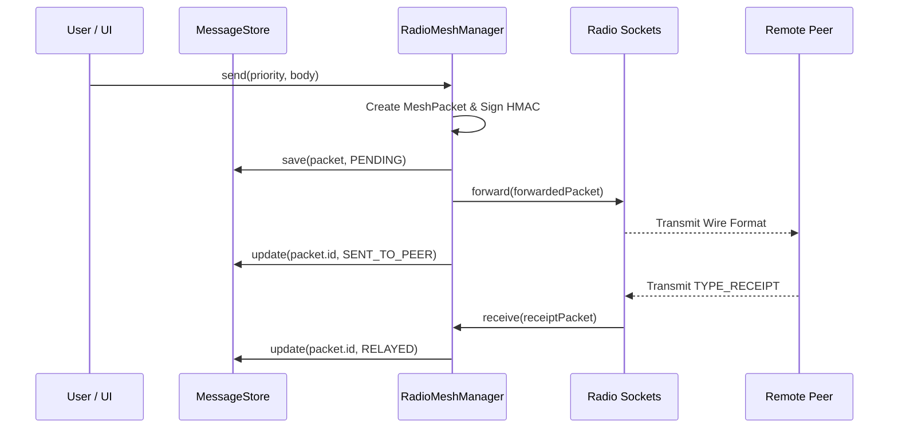

# 🏗️ OFFGRID System Architecture & Technical Design

---

## 1. Architectural Philosophy

OFFGRID is designed around three non-negotiable principles for disaster resilience:

1. **Air-Gapped Operation**: Complete absence of the `android.permission.INTERNET` manifest permission. No telemetry, cloud servers, DNS, or central brokers.
2. **Dynamic Mesh Convergence**: Automatic peer discovery across heterogeneous radio protocols (Bluetooth Classic, BLE, and Wi-Fi Direct).
3. **Resilient Store-and-Forward**: Persistent outbox caching so messages queued during network partition are automatically flushed upon reconnecting with any peer.

---

## 2. Component Hierarchy

```
+-------------------------------------------------------------------+
|                           UI Layer                                |
|        MainActivity  *  TopologyView  *  BottomSheet Dialogs       |
+---------------------------------+---------------------------------+
                                  |
+---------------------------------v---------------------------------+
|                         Service Layer                             |
|               MeshService (Foreground Service)                    |
+---------------------------------+---------------------------------+
                                  |
+---------------------------------v---------------------------------+
|                    Mesh Coordination Runtime                      |
|                        RadioMeshManager                           |
|       +-------------------------+-------------------------+       |
|       |     Peer Directory      |   Outbox / Store Queue  |       |
|       |   (ConcurrentHashMap)   |     (MessageStore)      |       |
|       +-------------------------+-------------------------+       |
+-------------------+-----------------------------+-----------------+
                    |                             |
+-------------------v-------------+   +-----------v-----------------+
|        Transport Layer          |   |       Security & Format     |
| - Bluetooth Classic (RFCOMM)    |   | - AES-256-GCM Encryption    |
| - BLE Beacon & Scan Filters     |   | - HMAC-SHA256 Signatures    |
| - Wi-Fi Direct Group Sockets    |   | - MeshPacket Wire Protocol  |
+---------------------------------+   +-----------------------------+
```

---

## 3. Data Flow & Packet Lifecycle



---

## 4. Power & Battery Management

Disaster scenarios often feature zero access to electrical mains for days. OFFGRID provides three power optimization modes:

| Mode | Scan Interval | Battery Impact | Primary Use Case |
| :--- | :--- | :--- | :--- |
| `POWER_NORMAL` | 60,000 ms (1 min) | Minimal | Idle civilian node monitoring for messages |
| `POWER_RELAY` | 30,000 ms (30 sec) | Balanced | Stationary base stations or intermediate relay nodes |
| `POWER_EMERGENCY` | 15,000 ms (15 sec) | High | Active search and rescue operations / SOS broadcast |

---

## 5. Security Architecture

1. **Zero Trust Wire Delivery**: Every incoming packet must pass cryptographic authenticity verification before local notification or relay propagation.
2. **Tamper Prevention**: Any modification to message contents, priority, hop history, or sender identity invalidates the HMAC-SHA256 signature and causes immediate drop.
3. **Confidentiality**: All packet bodies are encrypted via AES-256-GCM. Unpaired eavesdroppers cannot inspect message contents or voice audio.
